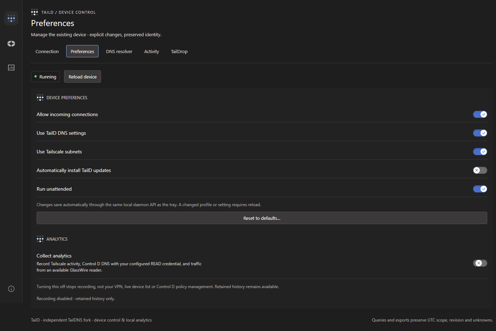
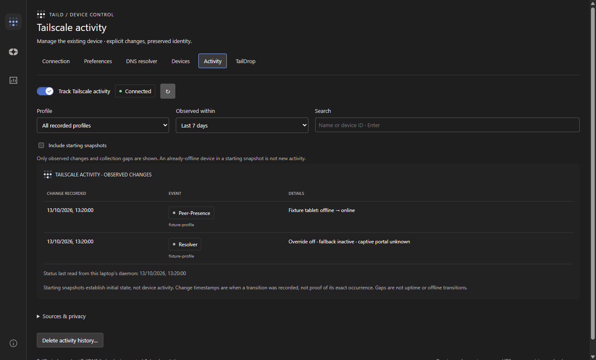

# TailD

Your tailnet and DNS decisions, on Windows and Android.

TailD expands **TailDNS connectivity** with **Control D analytics and incident
management**. Windows also integrates **GlassWire traffic measurements** in the
desktop interface. Android uses native device, DNS and scoped-history views with
automatic system light/dark mode; app bandwidth and blocking remain later work.

[Download for Windows](https://github.com/Darkaxt/TailD/releases/latest) ·
[Android downloads and upgrade notes](docs/taild/ANDROID.md) ·
[Specifications](docs/taild/PRODUCT-SPECIFICATION.md) ·
[Issues](https://github.com/Darkaxt/TailD/issues)


*Actual native TailD UI, refreshed October 16, 2026 from development main using synthetic demo data.
The screenshots contain no real accounts, browsing history or personal application paths.*

## What TailD brings together

The table and gallery below describe Windows. The [Android guide](docs/taild/ANDROID.md)
covers its native Tailscale, Control D and Dashboard destinations, existing-package
upgrade, separate release channel and battery-conscious history collection.

| Capability | What you can inspect |
|---|---|
| Control D decisions | DNS questions, raw actions and reasons, bypassed/blocked/redirected/failed outcomes, endpoint scope and decision history. |
| Application traffic | Received/sent bytes, executable identities, ranked consumers, destinations and bandwidth history from existing GlassWire counters. |
| Answer geography | Provider-reported country/ASN decision counts and an offline world map; switch explicitly to inferred traffic-byte geography. |
| Activity explorer | Typed filters, grouping, sorting, pagination, application and time-bin drill-down, saved local queries and expandable source evidence. |
| Incident management | Endpoint/profile associations, shared-device impact, searchable recent resolutions, Block / explicit Bypass / Edit rule actions, and confirmed filter/service/profile-option changes. |
| Policy inspection | READ snapshots of clients, rules, filters, services, groups, options and restrictions—with unavailable capabilities kept visible. |
| Local history | Opt-in independent collectors, ingestion progress, pause/resume, retention and deletion, coverage gaps, corrections and private JSON/CSV exports. |
| TailDNS connectivity | Inherited DNS improvements, MagicDNS-aware resolution, the Windows tray, matching daemon/CLI, and installer/updater integration. |
| Device control | Category-specific Connection, Preferences and DNS resolver pages; autosaved tray preferences, exit-node controls, and a persistent bottom-left About page. |
| Tailscale activity | Opt-in visible-device presence history, connection/exit-node/DNS-recovery observations, and durable TailDrop metadata, independent of Control D and GlassWire. |

Control D remains responsible for its DNS filtering. GlassWire and Windows keep
their firewall roles. TailD does not install another packet-filtering engine or
change firewall policy. Incident Allow/Block taps use fresh safety checks and
verified readback; Edit and other management changes use explicit review and a
separate Write credential. Collection remains READ-only.

The sidebar keeps Tailscale, Control D and Analytics category icons visible while
showing only the selected category's pages. Control D opens on recent DNS activity;
profile policy is a separate tab. The tray remains available for account sign-in
and Taildrop. These navigation/control additions are available starting with
**1.105.0+11**.



<details>
<summary>Device DNS resolver</summary>


</details>

### Tailscale-native history

The **Connection** page includes a live, searchable device inventory with owners,
addresses, OS, offline last contact, routes/tags, TailDrop eligibility and reported
capability metadata. It works even when recording is off. **Activity** and
**TailDrop** retain observed changes and daemon-reported transfer results.
One **Collect analytics** preference under **Tailscale → Preferences** controls
recording across available integrations. No Control D token or GlassWire
installation is required for Tailscale observations. Irrelevant analytics widgets
are hidden when their source is missing and no history exists; retained history
stays available through outages and when recording is disabled.


Offline peers show Tailscale's supplied **Last online** time, not the time this
page read their status. Activity shows actual recorded changes and observation
gaps; starting snapshots remain available through an explicit option.



<details>
<summary>TailDrop history</summary>


</details>

Online is control-plane presence, not ping reachability. Received by daemon is
not proof of a save to Downloads. Gaps and unknown outcomes stay explicit; past
unobserved transfers and uptime are not invented. Read the
[source, privacy and history contracts](docs/taild/TAILSCALE-ACTIVITY.md).

### Resolve DNS incidents without opening the browser

Inspect the enforced profile and every endpoint it affects. Review blocked
resolutions with their provider-supplied filter/list, service or rule trigger,
and descriptive category details. Create a Block or explicit Bypass exception,
or edit existing rules, filters, services and profile options.


<details>
<summary>Profile policy, separate from recent resolutions</summary>


</details>

Writes are never retried automatically. Changed policy/bindings invalidate the
preview; successful actions are read back. READ and Write credentials stay in
separate owning-user Windows vault entries, never in the dashboard or repository.
Live DNS streams persist independently of the window, with historical overlap
reconciled without treating collection gaps as zero traffic.

Development main reuses the collector's session policy snapshot when you revisit
Control D. **Reload policy** explicitly fetches provider-side changes; credentials
and endpoint/account bindings cannot share cached policy. Preview and Apply still
check current policy independently. Recent DNS has its own compact refresh icon
with keyboard support and an accessible label.

## Explore the network, not just a wall of counters

### DNS outcomes and geography

See the provider's decisions independently of local application attribution.
Country tiles coordinate with the map; selecting a country or outcome opens the
matching source facts. Missing geography stays visible rather than becoming a
fabricated location.


### Applications and evidence

Find the busiest executables by their readable process names, retain full paths
for identity and drill-down, and inspect the underlying observations. Duplicate
basenames remain separate applications.


<details>
<summary>See the activity and evidence explorer</summary>


Evidence preserves raw provider/source fields, exact counters, observation times
and the correlation method. JSON/CSV exports use the selected scope and revision,
not just the visible page.

</details>

## Honest metrics by design

- A DNS decision is not a socket or a transferred byte.
- GlassWire supplies application/time-bucket counters, not individual PID/socket lifetimes.
- A matching DNS answer is a versioned temporal candidate—not proof of which process issued the query.
- Answer geography is not a measured route or the device's physical location.
- Missing collection coverage is not zero activity. Failed and unknown provider actions are not silently classified as allowed.
- A policy snapshot describes an observation, not proof of which historical rule caused a decision.

Queries preserve one committed history revision and exact integer counters.
Completed DNS panels can appear while traffic aggregation continues; loading
state and source progress remain explicit.

## Get started on Windows

1. Download the installer from [TailD releases](https://github.com/Darkaxt/TailD/releases/latest).
2. Follow the Windows installation/migration instructions in the release notes.
   The integrated installer targets the existing Tailscale installation and
   preserves its authenticated state; do not manually delete its state or signing keys.
3. Open **TailD** from Start or left-click its tray icon. Right-click opens the
   connectivity menu.
4. In **Analytics → Collection settings**, select the Control D account/endpoint
   and supply a **READ-only** token. Enable **Collect analytics** under
   **Tailscale → Preferences**; compatible GlassWire traffic and configured
   Control D DNS are selected automatically. Viewing retained history does not
   enable recording, and recording never changes VPN/DNS preferences.
5. For incident management, register a separate Write token using the documented
   [secure credential flow](docs/taild/POLICY-READS.md). No Write token is needed
   for analytics or live DNS collection.

The analytics desktop is currently Windows amd64. Control D data requires a
readable account/endpoint; traffic analytics require an existing compatible
GlassWire installation. The restricted GlassWire reader needs administrator
setup; the dashboard and owning-user collector run without elevation.

Windows payload/installer digests and update metadata are Ed25519-signed.
The executables and installer are **not Authenticode-signed**. Review the
[packaging and trust boundaries](docs/taild/PACKAGING.md).

### Release versus development main

The Windows reference release is
[1.105.0+27](https://github.com/Darkaxt/TailD/releases/tag/windows-v1.105.0%2B27),
including compact device controls and DNS incident actions, seven-day historical
cross-checks and the analytics reconnection repair. The October 16 gallery may
show older layouts; its facts are explicitly synthetic, with capture provenance.
Android +34 is undergoing its final signed delivery and upgrade acceptance; the
[execution ledger](docs/taild/IMPLEMENTATION-PLAN.md) records the current boundary.

Desktop Stage 10 is parked at the unresolved real B12 acceptance boundary; this
README does not claim every deployment, recovery or lifecycle scenario is
complete. See the [current reconciliation and validation limits](docs/taild/IMPLEMENTATION-PLAN.md).

## Built on TailDNS, kept in sync

TailD is a public, history-preserving derivative of
[Darkaxt/TailDNS](https://github.com/Darkaxt/TailDNS), with the shared Windows/core
implementation pinned through [Darkaxt/tailscale](https://github.com/Darkaxt/tailscale).
Its native Android client is the expanded TailDNS derivative described in the
[Android specification](docs/taild/ANDROID-EXPANSION-PROPOSAL.md). The maintained
[TailDNS Android releases](https://github.com/Darkaxt/TailDNS/releases) remain a
separate product/update origin; existing TailDNS clients are not redirected.

The daily **Inherit TailDNS improvements** workflow checks the exact candidate and
core pin, preserves fork contracts and promotes passing history to main. Failed
checks or conflicts stop promotion; main is not force-pushed. Inheritance itself
does not publish releases or install updates on devices. GitHub's one-fork-per-
network limit means this repository preserves Git history without a second native
GitHub fork badge.

## Documentation and development

- [Product specification and staged acceptance](docs/taild/PRODUCT-SPECIFICATION.md)
- [Implementation status, evidence and remaining blockers](docs/taild/IMPLEMENTATION-PLAN.md)
- [Metrics, typed queries and correlation contracts](docs/taild/METRICS-QUERY.md)
- [Control D policy reads and credentials](docs/taild/POLICY-READS.md)
- [GlassWire source capabilities and limitations](docs/taild/GLASSWIRE-READS.md)
- [Collector lifecycle and privilege boundary](docs/taild/CONTINUOUS-RUNTIME.md)
- [Desktop design and native validation](docs/taild/DESKTOP-ANALYTICS.md)
- [Windows packaging and verification](docs/taild/PACKAGING.md)
- [TailD Android scope, downloads and upgrades](docs/taild/ANDROID.md)
- [Inherited Android build reference](docs/INHERITED-ANDROID.md)

The desktop uses Angular in a native WebView2 host. Frontend and native dependency
locks, local package tooling, isolated signing and independent artifact checks
live in this repository. Backend tests use explicitly owned scratch:

```powershell
$env:TAILD_PACKAGE_TEST_OUTPUT = 'D:\Temp\taild-tests'
New-Item -ItemType Directory -Force -Path $env:TAILD_PACKAGE_TEST_OUTPUT | Out-Null
python -B -m unittest discover -s scripts/taild -p 'test_*.py' -v
```

Screenshot reproduction uses
[scripts/taild/capture_readme_windows.py](scripts/taild/capture_readme_windows.py)
with an isolated Debug host and a new scratch directory. It creates only
synthetic facts and makes no provider requests. The
[capture provenance](docs/taild/screenshots/capture-provenance.json) records the
actual served assets, screenshot hashes and policy-revisit verification.

## Attribution and license

TailD is an independent community fork, not an official Tailscale product or
endorsed by Tailscale, Control D, GlassWire or Safing.

Original Tailscale code retains its [BSD 3-Clause license](LICENSE). The
Portmaster-derived desktop widgets retain their [GPL-3.0 license](desktop/LICENSE),
[reuse notices](desktop/NOTICE.md) and upstream attribution. See the
[Portmaster design/source map](docs/taild/PORTMASTER-DESIGN.md) for the adaptation.
Tailscale and other product names remain their owners' trademarks. WireGuard is a
registered trademark of Jason A. Donenfeld.

Contributions require Developer Certificate of Origin `Signed-off-by` lines.
