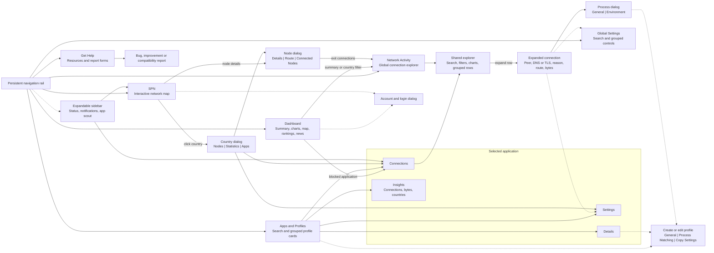

# Portmaster layout report

Portmaster organizes its desktop interface around six primary destinations,
with a persistent navigation rail and an optional application/status sidebar.
Its distinguishing pattern is **summary → filtered connections → evidence or
application settings**, not a collection of independent dashboard cards.

This map covers the current `development` source at
[`bb6c44468a5d66bddb13bf3c43fcb2625c326ca9`](https://github.com/safing/portmaster/tree/bb6c44468a5d66bddb13bf3c43fcb2625c326ca9),
checked on 2026-10-14. It describes declared layouts and navigation, not a
runtime walkthrough of a particular installed release or subscription.
The [full layout and widget inventory](PORTMASTER-LAYOUT-MAP.md) records the
conditions, actions, shared components and source references behind this graph.

## Navigation graph

Solid arrows represent navigation, drill-downs or contained tabs. Dashed arrows
represent contextual actions or globally accessible overlays. Graph labels
summarize widget families; the inventory lists individual widgets.

## Findings

- **Dashboard:** six summary metrics; connection and SPN time series; country
  tiles and a world map; blocked-application rankings; stacked top-consumer and
  bandwidth charts; feature cards and a news carousel. Bandwidth and SPN
  widgets have separate entitlement gates.
- **Applications:** each selected application has four tabs—Connections,
  Settings, Details and Insights—beneath a shared identity, quick-settings and
  statistics header. Connections reuses the global explorer with application
  scope enforced.
- **Activity:** search, filter chips, date range, grouping, sorting, charts,
  pagination and expandable evidence form one reusable exploration workflow.
  Connection evidence can open process details or the setting responsible for
  a decision.
- **Maps:** the Dashboard map highlights connection countries. The separate
  SPN map adds nodes, paths, draggable overlays and country/node dialogs. A
  geographic widget does not imply SPN functionality.
- **Settings and support:** these are full workflows, including inheritance,
  rule/list editors, import/export, contextual help and report preparation—not
  plain information pages. Feature names, setting categories and news cards
  can be supplied dynamically.

For TailD, the strongest reusable design relationships are the persistent
application scout, consistent explorer, application tabs, coordinated
geography/rankings and evidence-to-context navigation. Portmaster's firewall
actions, SPN controls and connection-lifetime metrics are **not** capabilities
TailD gains merely by adopting the layout.

Two source cautions matter before literal reuse: the wildcard route precedes
the Dashboard declaration, and the application Insights country query lacks
the application predicate used by its other charts. These are source
observations, not runtime reproductions. No product code or live installation
was changed for this report.
